# ProcessOS and Rainbow Corp — Local Workflow Automation Demo

**Author:** Shubham Kumar Singh  
**License:** MIT


ProcessOS is a local workflow-engineering studio for describing a business process in plain language, validating its integration endpoints, reviewing a workflow blueprint, and running a bounded build-verification gate before an explicitly authorized local deployment. The included Rainbow Corp application demonstrates the workflow against a refund-request use case with routing, human review, status updates, and a mock refund service.

> **Demo boundary:** This is an independent demonstration, not an official Camunda product. The refund service returns synthetic results only; no real bank, payment provider, or money movement is involved. The current ProcessOS deployment adapter targets the included Rainbow Corp refund integration contract and is not a universal adapter for arbitrary applications.

## Features

- **Natural-language process discovery:** clarify triggers, business rules, decisions, integrations, and expected outcomes before building.
- **Endpoint probing:** check configured HTTP/API and WebSocket integration endpoints before workflow generation proceeds.
- **Reviewed workflow blueprint:** inspect the process ID, threshold, endpoint paths, and business rules before generating the workflow.
- **Bounded Coder/Tester gate:** check the generated BPMN and related artifacts with a maximum of three iterations in the studio interface; a failed gate blocks deployment.
- **Camunda integration:** use a controlled local CLI path to check prerequisites and deploy the verified BPMN to a local Camunda 8 development runtime after explicit authorization.
- **Human-in-the-loop routing:** refund requests above **₹5,000** require human review. Rejection bypasses the mock refund task; approval allows the workflow to continue.
- **Operational visibility:** review refund requests, master data, human-review decisions, activity records, and workflow status updates.
- **Separated responsibilities:** keep the customer application independent from the workflow bridge and mock refund service.

## Architecture

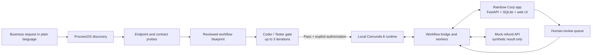

### Components

| Component | Responsibility | Default local address |
|---|---|---|
| ProcessOS Studio | Discovery, endpoint probing, blueprint review, Coder/Tester gate, local Camunda control | `http://127.0.0.1:8090` |
| Rainbow Corp app | Refund intake, request tracking, and customer status | `http://127.0.0.1:8000` |
| Rainbow Corp admin console | Request register, product/customer master data, human-review queue, and activity log | `http://127.0.0.1:8000/admin` |
| Mock Refund API | Simulated refund outcome and synthetic transaction reference | `http://127.0.0.1:8001` |
| Local Camunda 8 runtime | Executes the deployed BPMN workflow in development | `http://127.0.0.1:8080/v2` |
| Workflow bridge | Dispatches requests, handles workflow jobs and review decisions, and syncs results to the application | Local process; no separate UI |

## Screenshots

All screenshots below use repository-relative links to image files in the repository root. Keep the image files alongside this `README.md` so GitHub can render them.

### ProcessOS Studio

#### Initial studio screens

**Discover & Probe**

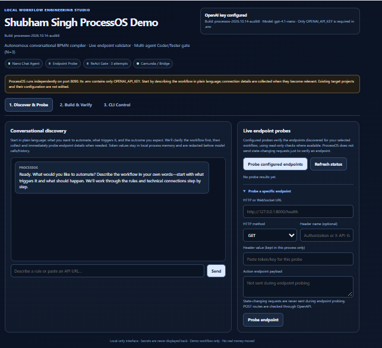

**Build & Verify**

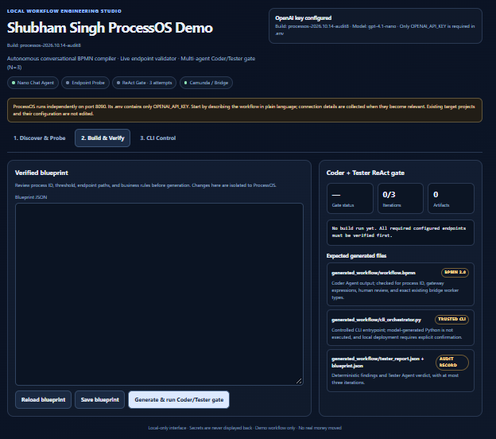

**CLI Control**

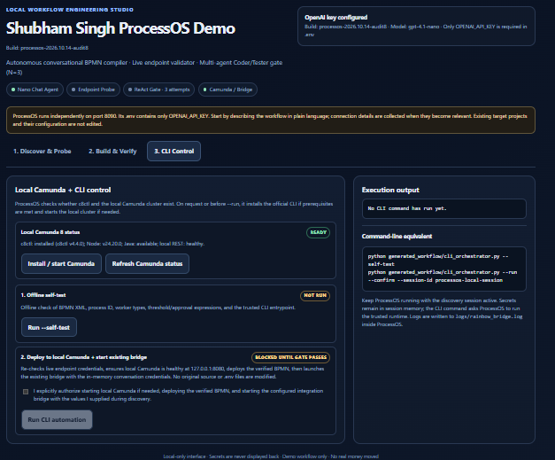

#### Discovery and endpoint verification

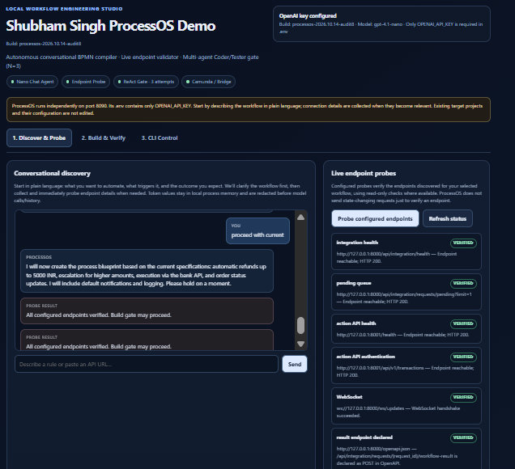

#### Verified workflow blueprint

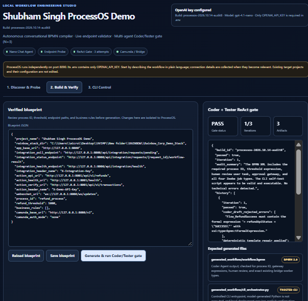

#### Local deployment gate

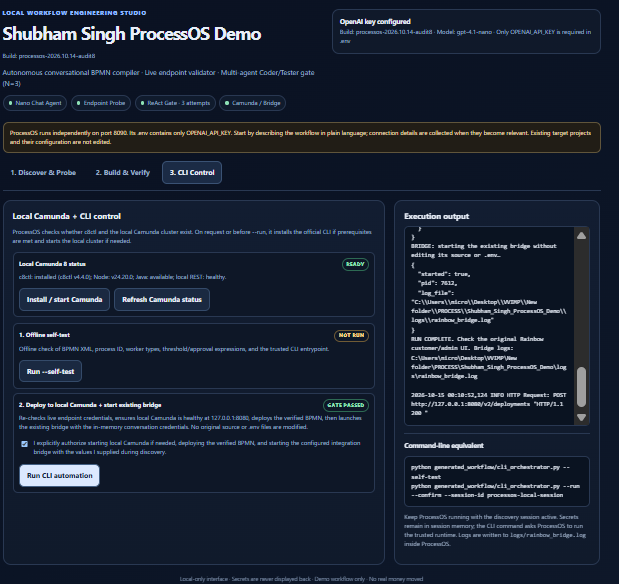

### Rainbow Corp refund flow

#### Customer intake

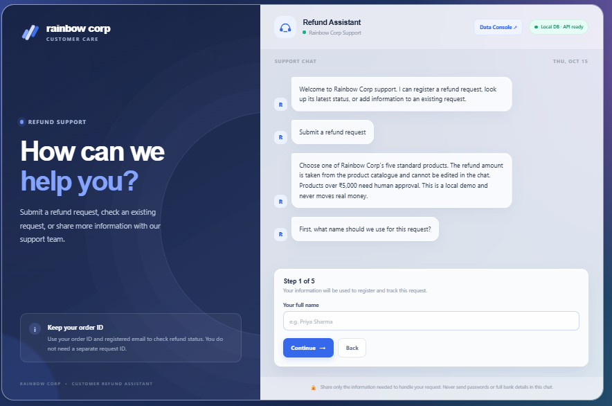

#### Request review before submission

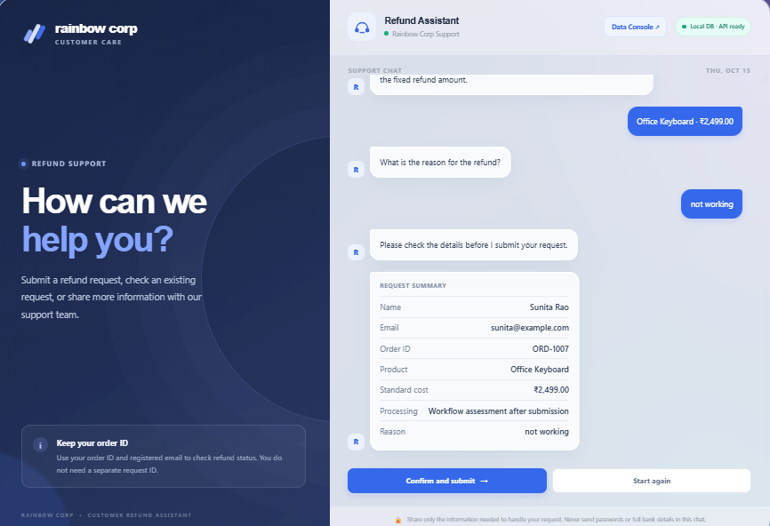

#### Simulated refund completion

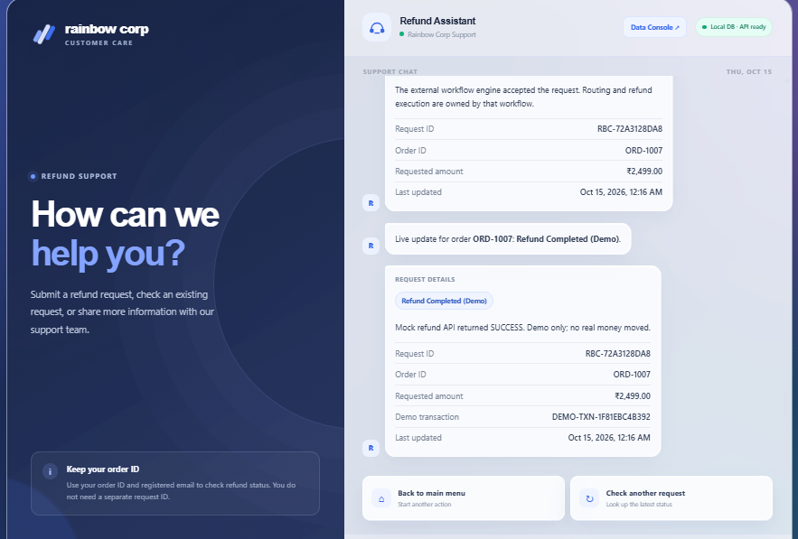

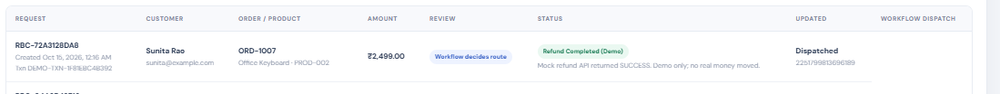

### High-value refund and human review

#### Request requiring review

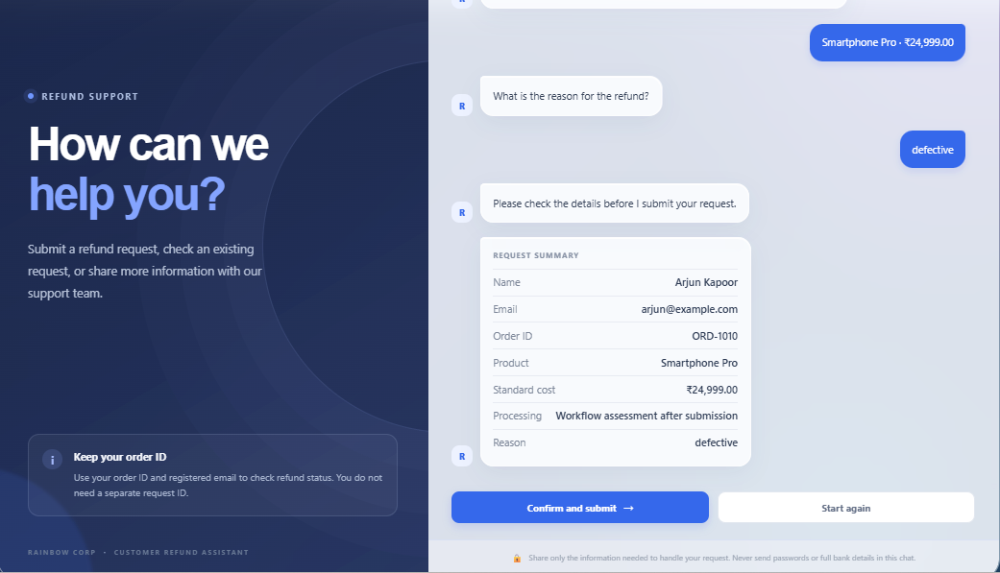

#### Workflow accepts the request

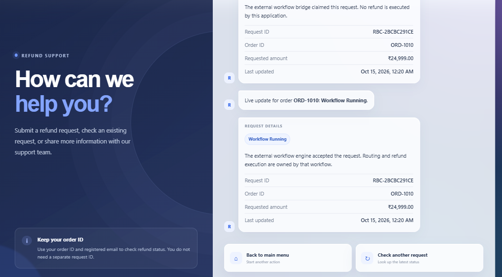

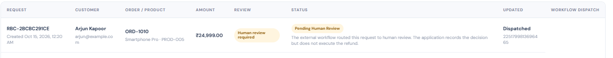

#### Human-review queue

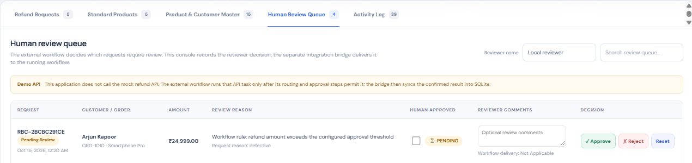

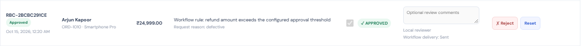

#### Result after the decision

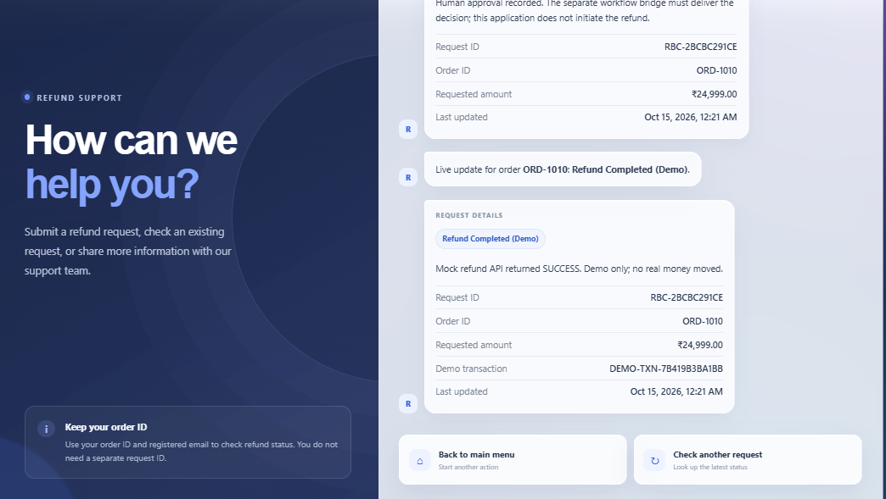

### Rainbow Corp admin console and pre-automation state

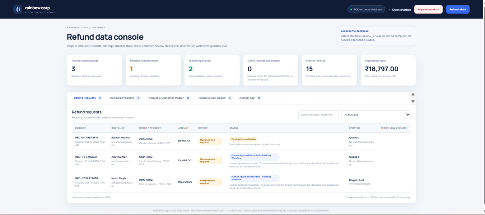

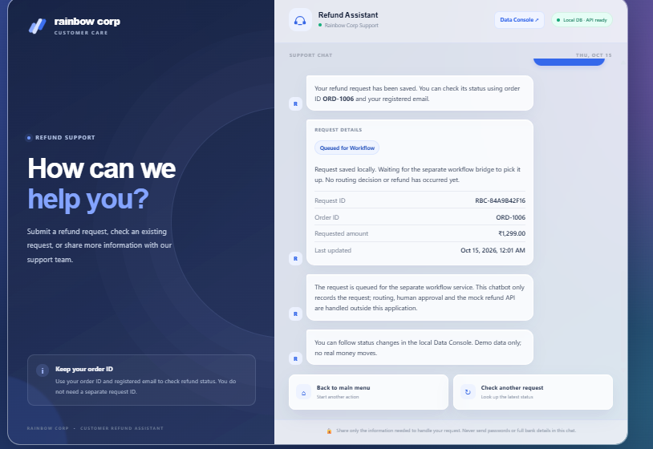

## Repository contents

The root-level `Clean_ProcessOS_and_RainbowCorp.zip` archive contains the application source. Extract it before running the components.

```text
.
├── README.md
├── Clean_ProcessOS_and_RainbowCorp.zip
├── processdemo_1.png
├── processdemo_2.png
├── processdemo_3.png
├── processdemo_auto1.png
├── processdemo_auto2.png
├── processdemo_auto3.png
├── afterauto_test.png
├── afterauto_test1.png
├── afterauto_test2.png
├── afterauto_test2result.png
├── afterauto_test3.png
├── afterauto_test3a.png
├── afterauto_test3b.png
├── afterauto_test3c.png
├── afterauto_test3d.png
├── afterauto_test3e.png
├── before_auto_admin_page.png
└── BEFORE_AUTOMATION.png
```

The extracted source bundle is organized into two top-level projects:

```text
PROCESS/
└── Shubham_Singh_ProcessOS_Demo/
    ├── main.py
    ├── processos_runtime.py
    ├── processos_studio_agent.py
    ├── camunda_manager.py
    ├── static/studio.html
    ├── generated_workflow/
    ├── tests/test_agent.py
    ├── requirements.txt
    ├── requirements-dev.txt
    └── run.bat

RAINBOW/
└── Rainbow_Corp_Demo_Stack/
    ├── rainbow_corp_app/       # Customer UI, API, admin console, SQLite records
    ├── local_bridge/           # Workflow integration bridge and workers
    ├── mock_refund_api/        # Simulated refund service
    ├── workflow_assets/        # BPMN process model
    └── tests/
```

## Run locally on Windows

Python 3.11 or newer is recommended for the demo services. Run each service in its own PowerShell terminal from the extracted project directory.

### 1. Configure local environment files

Copy the relevant `.env.example` files to `.env` where required and set local demo credentials according to each component's README. Do not commit `.env` files or real credentials.

- ProcessOS uses `OPENAI_API_KEY` for model-backed discovery. Its model default is `gpt-4.1-nano`.
- The Rainbow Corp application and workflow bridge must use the same `INTEGRATION_API_TOKEN`.
- The workflow bridge and mock refund API must use the same `DEMO_REFUND_API_KEY`.
- Configure the workflow REST address and credentials in the bridge environment for the Camunda runtime you use.

Use your own randomly generated demo secrets. Do not use example values as production secrets.

### 2. Start the Rainbow Corp application

```powershell
cd RAINBOW\Rainbow_Corp_Demo_Stack\rainbow_corp_app
.\run.bat
```

Open `http://127.0.0.1:8000` for the customer assistant and `http://127.0.0.1:8000/admin` for the local data console. API documentation is available at `http://127.0.0.1:8000/docs`.

### 3. Start the mock refund API

In a separate terminal:

```powershell
cd RAINBOW\Rainbow_Corp_Demo_Stack\mock_refund_api
.\run_mock_api.bat
```

Its health endpoint is `http://127.0.0.1:8001/health`.

### 4. Start ProcessOS Studio

In a separate terminal:

```powershell
cd PROCESS\Shubham_Singh_ProcessOS_Demo
.\run.bat
```

Open `http://127.0.0.1:8090`. Describe the workflow, provide the relevant integration details when prompted, probe the configured endpoints, review the generated blueprint, and run the Coder/Tester gate. Deployment remains behind an explicit local authorization step.

### 5. Run the workflow bridge

Configure `RAINBOW\Rainbow_Corp_Demo_Stack\local_bridge\.env` using its `.env.example`. Start or configure your local Camunda 8 runtime, deploy the BPMN process using the provided deployment script, and then start the bridge using `run_bridge.bat`. Follow the component README for the correct credentials and deployment configuration for your environment.

The included ProcessOS deployment path is designed for the specific Rainbow Corp contract. Its required integration details include the `X-Integration-Key` and `X-Demo-API-Key` headers, the `/api/v1/refunds` action endpoint, and the worker types `register-human-review`, `execute-demo-refund`, `sync-refund-result`, and `record-refund-rejection`. Incompatible contracts are expected to be blocked rather than silently rewriting the existing application or bridge.

## Workflow behavior

1. A customer submits a refund request through the Rainbow Corp assistant. The request is saved locally in a queued state.
2. The workflow bridge picks up the request and starts a process instance.
3. The BPMN amount gateway routes requests of **₹5,000 or less** to automatic demo processing and requests **above ₹5,000** to the human-review task.
4. A reviewer can approve or reject a request through the admin console. Rejection bypasses the refund API.
5. When approved, the workflow can call the mock refund service. The bridge syncs its synthetic transaction reference and final status back to the local app.
6. The customer UI and admin console show the resulting status.

No real refund is issued. The sample services and records are for local demonstration only.

## Tests

Run each test suite from its relevant project folder after installing dependencies.

ProcessOS:

```powershell
cd PROCESS\Shubham_Singh_ProcessOS_Demo
python -m pip install -r requirements-dev.txt
python -m pytest -q
```

Rainbow Corp:

```powershell
cd RAINBOW\Rainbow_Corp_Demo_Stack
python -m pip install -r rainbow_corp_app\requirements.txt -r local_bridge\requirements.txt -r mock_refund_api\requirements.txt pytest
python -m pytest -q tests
```

Recorded local test results for this bundle: **28 ProcessOS tests passed** and **22 Rainbow Corp tests passed**. Passing local tests does not by itself verify a fresh machine setup or prove that an external Camunda cluster is configured and reachable.

## Security and limitations

- Keep all demo services bound to loopback (`127.0.0.1`) unless you have added suitable authentication and network controls. The sample admin console is not designed to be exposed publicly.
- Never commit `.env` files, API keys, OAuth credentials, runtime databases, or real customer data.
- Endpoint probes validate reachability and integration contracts; they are not intended to execute refund actions.
- ProcessOS keeps discovered credentials in the running local session and redacts them from model-facing chat text. Restarting the application clears the in-memory session; repeat discovery and probing before running a workflow again.
- The Coder/Tester gate checks generated workflow artifacts deterministically. A failed verification gate blocks deployment.
- The workflow adapter currently supports the bundled Rainbow Corp refund contract. Other applications require a compatible contract and integration adapter.
- The mock refund service creates synthetic results only. No real money moves.
- Names, emails, order details, and transaction IDs shown in the screenshots are sample demo data.

## References

- [Camunda](https://camunda.com/)
- [Camunda 8 CLI (`c8ctl`) getting started](https://docs.camunda.io/docs/apis-tools/c8ctl/getting-started/)
- [Camunda 8 CLI source repository](https://github.com/camunda/c8ctl)

## Author

**Shubham Kumar Singh**

## License

This project is licensed under the MIT License.

Copyright (c) 2026 Shubham Kumar Singh

Permission is hereby granted, free of charge, to any person obtaining a copy
of this software and associated documentation files (the "Software"), to deal
in the Software without restriction, including without limitation the rights
to use, copy, modify, merge, publish, distribute, sublicense, and/or sell
copies of the Software, and to permit persons to whom the Software is
furnished to do so, subject to the following conditions:

The above copyright notice and this permission notice shall be included in all
copies or substantial portions of the Software.

THE SOFTWARE IS PROVIDED "AS IS", WITHOUT WARRANTY OF ANY KIND, EXPRESS OR
IMPLIED, INCLUDING BUT NOT LIMITED TO THE WARRANTIES OF MERCHANTABILITY,
FITNESS FOR A PARTICULAR PURPOSE AND NONINFRINGEMENT. IN NO EVENT SHALL THE
AUTHORS OR COPYRIGHT HOLDERS BE LIABLE FOR ANY CLAIM, DAMAGES OR OTHER
LIABILITY, WHETHER IN AN ACTION OF CONTRACT, TORT OR OTHERWISE, ARISING FROM,
OUT OF OR IN CONNECTION WITH THE SOFTWARE OR THE USE OR OTHER DEALINGS IN THE
SOFTWARE.
